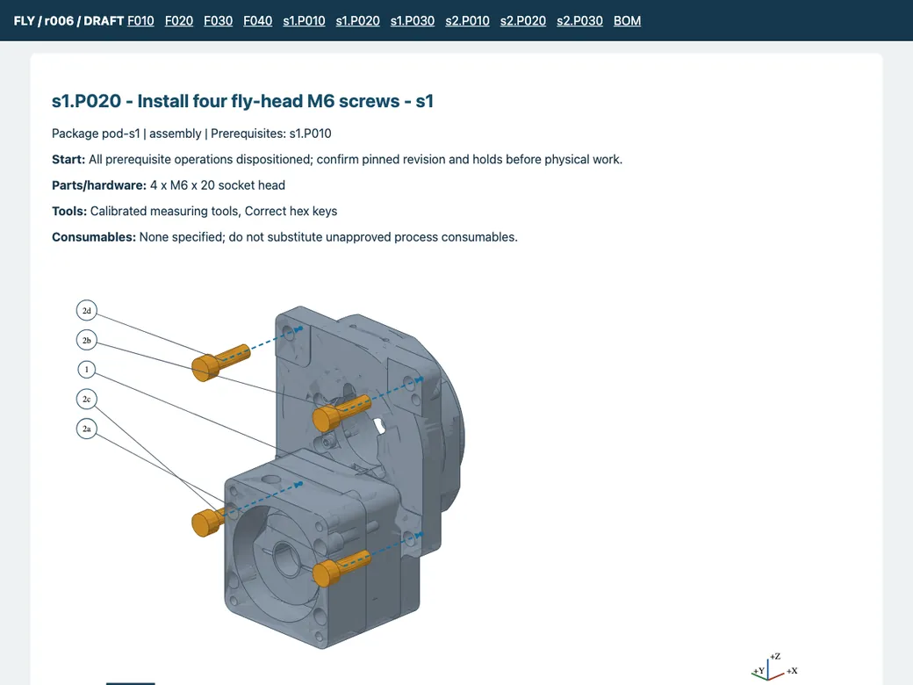
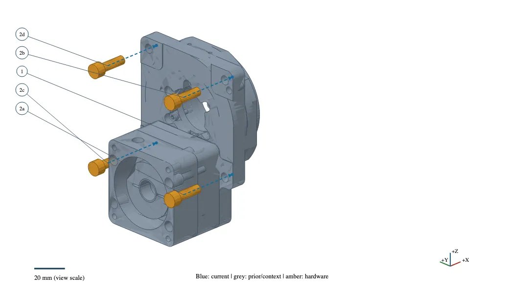
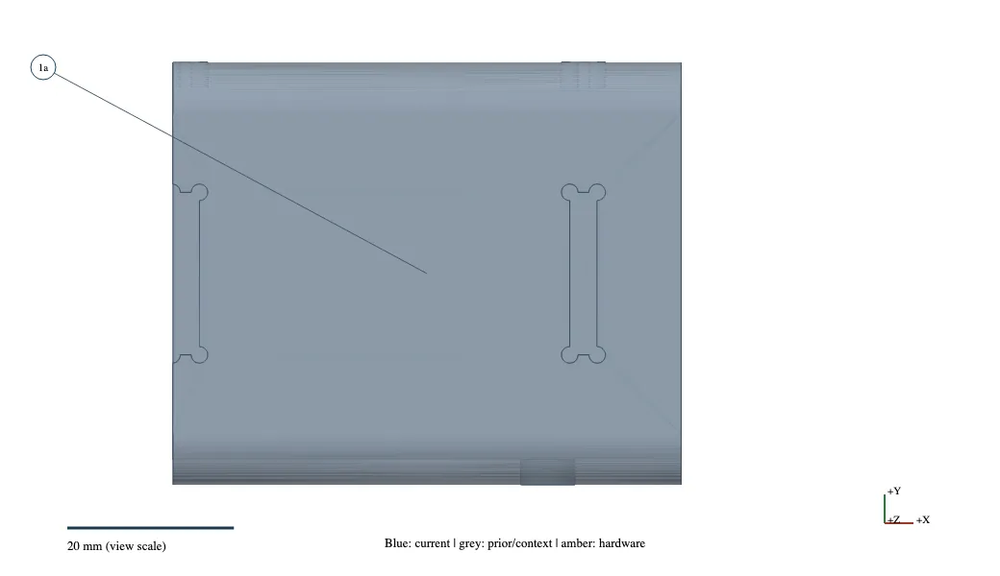
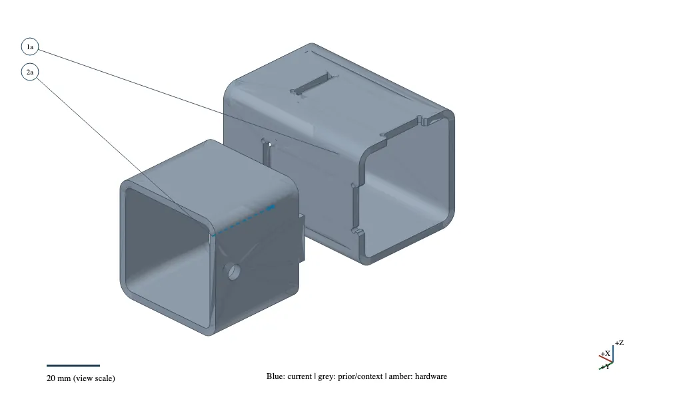

# CAD as Config, part 3

The [first post](https://gwaihirrobotics.com/blog/2026-08-cad-as-config) described our way of generating CAD from config. The [follow-up](https://gwaihirrobotics.com/blog/2026-10-cad-as-config-two-months-on) covered what happened when that pattern spread into motion, procurement and the factory layout. This time the question is simpler: can someone other than the designer use the output to build the machine?

A finished model does not answer that. It can show where every part ends up while saying very little about what arrives from the supplier, which operation comes first, or what still needs engineering judgment. The designer carries those details in their head. A second person does not.

We have started turning that missing information into a versioned process definition beside the CAD. The first pilot covers the frame and fly-drive subassemblies of the two-station winder we called Swift in the last post. It produces a local HTML guide and a printable PDF from the same inputs. It is a draft pilot, not a released fabrication procedure or evidence that an independent assembler has completed the machine from it.

<figure>

<figcaption>A draft operation in the offline guide: starting condition, required hardware, illustration and checks.</figcaption>
</figure>

## The process is authored, not guessed

The model supplies geometry. The process definition supplies the sequence, prerequisites, tools, hardware, directions and completion checks. We keep them separate so that changing a camera cannot move a part in the real assembly, and changing an illustration cannot quietly invent a weld requirement.

Each operation names its starting condition, the parts it installs, the parts it shows for context, its checks and any unresolved requirements. Operations belong to work packages that can be assigned separately. The frame package includes member identification, locating the joints and dimensional inspection. The drive-module package shows a head being positioned, its mounting screws, and the servo interface. The second station reuses the process while retaining different installed-instance IDs.

One practical lesson came from a received sheet-metal cover. The assembly CAD showed its finished features, but the supplied cut-and-form blank still needed secondary machining. The guide has to represent that transition. A solid that passes the geometry checks does not tell a machinist that the drilling and tapping have already been done.

Unknown weld requirements, torque, fit and acceptance limits stay as explicit holds. We do not fill them in because a plausible number would make the document look more complete.

## One part number, four places to put it

Our first pictures gave four identical screws four unrelated bubble numbers. That made the reader do the grouping mentally.

The revised view gives the common part one number and each installation a suffix. Four M6 × 20 screws become **2a, 2b, 2c and 2d**. The key says **bubble 2: quantity 4**. A different screw length gets a different part group, even if it has the same thread diameter.

<figure>

<figcaption>Four M6 x 20 screws share bubble 2, with distinct locations 2a–2d. The darker context model retains the mounting details.</figcaption>
</figure>

The suffixes identify locations, not new part numbers. Underneath the drawing, each still maps to a unique installed instance. That matters later if the assembler reports that the screw at 2c bottoms out, or if one station needs rework while the other is fine. Detail views keep the parent operation's labels rather than renumbering the parts they happen to show.

## A frame overview is not a joint detail

The frame overview is useful for identifying members and finding joints. It is a poor way to explain a small dogbone relief in a receiving slot.

We added local close-ups taken from the actual CAD. One looks at the receiving member before the post is installed. Another pulls the lower-ring corner apart; a third does the same for the spanner connection. The geometry adapter crops copies of the solids and uses a finer mesh for these views. It does not save those cuts or exploded placements back into the assembly.

<figure>

<figcaption>Close-up of the actual receiving dogbone slots before post installation. This is cropped CAD geometry, not a fabrication release.</figcaption>
</figure>

<figure>

<figcaption>The lower-ring corner pulled apart to expose the tab-and-slot connection. The displayed gap and cropped ends are presentation only.</figcaption>
</figure>

Those pictures show the tab, slot and relief rather than a generic sketch of how we think the joint ought to work. The cut ends in the close-up are presentation boundaries, not additional fabrication cuts. The joint IDs still tie back to the full frame view and inspection steps. They locate interfaces; they are not weld symbols or a qualified tack-and-weld sequence.

We also had to make the models darker. Pale context parts looked unobtrusive on screen and lost the holes and mating surfaces on white paper. The current views use stronger face shading and thin feature outlines, with blue for current parts and amber for hardware. We inspect the printed pages as well as the enlarged figures.

## A guide has to stay attached to the design it describes

A Git commit is not enough when the designer has relevant uncommitted changes. The package records hashes of the actual CAD, config, BOM and process inputs, and snapshots the source bytes and generator code.

Regeneration compares part instances, geometry and process definitions, then follows prerequisites to identify downstream operations that need review. A rendering change can require a visual review of the whole guide. Earlier instruction revisions remain available. A build already in progress stays pinned to the revision it started with.

The HTML works from local files, without an account or a server. The PDF uses the same operation, figure and callout keys. The package also exports the process, BOM and bubble-to-instance mapping as JSON. It does not pretend that browser checkboxes are durable manufacturing records.

File size needed attention too. Detailed vector CAD figures are useful in the authoritative package but can make a PDF cumbersome to send. We now have a separate sharing export that rasterizes the figures while retaining searchable instruction text and figure labels. The sharing copy of this pilot is about 1.7 MB, and the original package stays intact. The images in this article are web-sized WebP screenshots with responsive sizes and lazy loading; the full PDF is not embedded in the page. The four article images total under 80 KB even at their larger resolution.

## The feedback path to FactoryOS

We inspected the FactoryOS architecture before drawing this boundary. It is still a proposed integration, with a local file/SQLite example rather than a dependency on a live service.

The example separates three things: the reusable instruction definition; a particular machine or subassembly being built against it; and the evidence and disposition from that build. Finishing an operation is separate from accepting its inspection result.

To exercise that separation, the demo reports a **simulated** register-fit problem against one installed head and one step. Engineering records an assessment and a rework request. A new process revision adds a fit-evidence check, and the dependent steps require review. The original build keeps its old instruction revision, rejected inspection, issue and rework history. None of that demo is presented as a measured physical defect.

The local outbox demonstrates repeated delivery without duplicate events. The live transport, authentication and production workflow still need to be matched to FactoryOS. This is supervisory build traceability; it does not control machine motion or safety functions.

## What is available

The reusable schema, geometry adapter, instruction compiler, grouped callouts, local record example and verification tools are in [CAD_as_Code on GitHub](https://github.com/Gwaihir-Robotics/CAD_as_Code). The [getting-started guide](https://github.com/Gwaihir-Robotics/CAD_as_Code/blob/main/docs/getting-started.md) explains the two Python environments, the offline outputs and which integration tests need the separate machine checkout.

The pilot is useful enough to expose the next questions, and that is the point of doing it on a real machine. We still need approved fabrication requirements, received-part checks and a review with the person who will do the work. The work instructions are another generated artifact with sources and checks, and another way for an actual build to send a precise question back to engineering.
