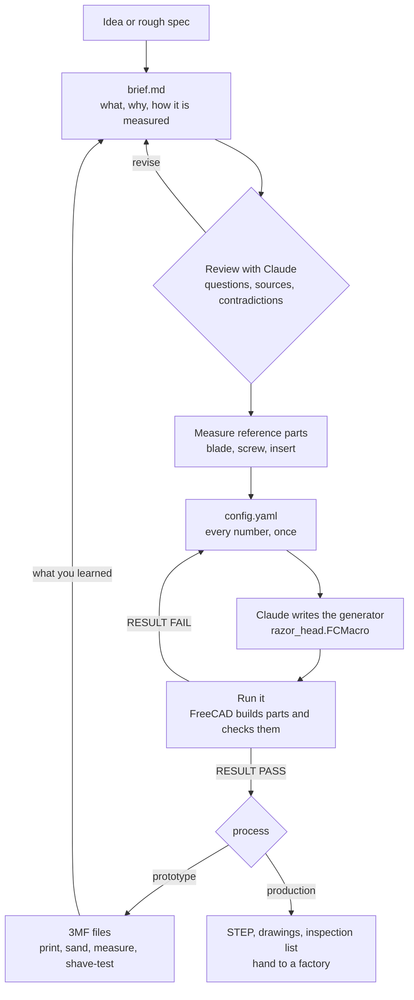
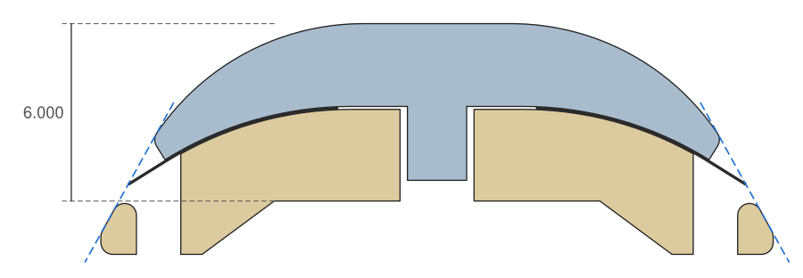
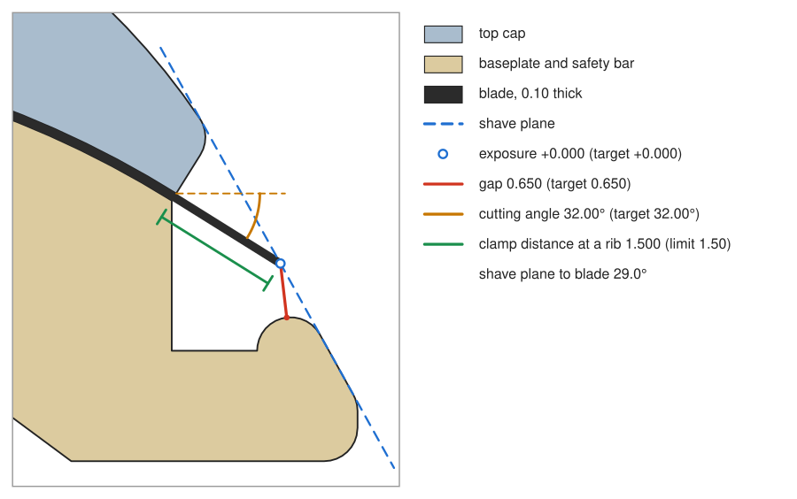

# Safety razor: a worked CAD-as-Code example

This folder follows one design from a rough idea to files you can print or
hand to a factory. The design is a three-piece double-edge (DE) safety razor: a
top cap and a baseplate, which clamp a standard blade between them, and a
handle. The plan is to print it in carbon-fibre-filled plastic as a working
prototype, then have a factory make it in brass or stainless steel.

A razor makes a good example because it is small, a few of its dimensions
decide whether it shaves well or cuts you, and it has to fit a part you buy
(the blade). If you are new to CAD as Code, read this page from top to bottom.
It shows each step, the files the step produces, and parts of the conversation
with Claude that shaped the design, including the mistakes.

> **This is an example of the workflow, and the design is untested.** We have not printed this head, measured it or shaved with it. The checks prove the model matches its config. They say nothing about how it shaves, and several config values are still estimates. If you build one, measure gap and exposure before you put it near your face.

You need Claude Code with the [cad-as-code skill](../../README.md) installed, and [FreeCAD 1.x](https://www.freecad.org/downloads.php), a free CAD
program. You never have to open FreeCAD's window; Claude runs it from the
command line.

## The workflow

With CAD as Code you don't draw the part. You describe it in text files, and a
program builds the 3D model from them and checks the result. The work moves
through three files:

- **The brief** ([brief.md](brief.md)) is the plan, in plain language. It says
  what the part is, what it attaches to, how each important dimension is
  measured, and which requirements must never be missed. You write it and
  review it with Claude.
- **The config** ([config.yaml](config.yaml)) holds the numbers. Each dimension
  appears once, with a note saying whether it is a requirement, the dimension
  of a bought part, or still a guess.
- **The generator** ([razor_head.FCMacro](razor_head.FCMacro)) is a program
  Claude writes for you. It reads the config, builds the parts in FreeCAD,
  measures them against each requirement, and reports pass or fail.



The order matters. You review the brief before anything is built because the
brief is the cheapest place to catch a mistake: a wrong idea there takes one
edited line to fix, and the same idea in a printed part costs you a reprint.
The diagram also loops back from printing to the brief. The first config is
full of estimates, and the measurements you take from a printed part replace
them.

## Razor terms used on this page

The brief defines these precisely. Short versions, so the steps below make
sense:

- **Safety bar**: the rail along the front of the baseplate. It rides on your
  skin just ahead of the blade.
- **Blade gap**: the distance from the blade's edge to the safety bar.
- **Shave plane**: the line touching the cap's edge and the safety bar, roughly
  where your skin sits during a stroke.
- **Exposure**: how far the blade's edge sits past the shave plane (positive)
  or behind it (negative).
- **Clamp distance**: how far back from the edge the cap and baseplate stop
  gripping the blade. A long unsupported edge vibrates.
- **Tier**: a gap and exposure pair. This example has three, from mild to
  medium-aggressive.

## Status

| Step | Status |
|---|---|
| 1. Brief | Done for the head: [brief.md](brief.md). The handle section is new and waiting for review |
| 2. Review | Two rounds done. A review of the passing build added questions on clamp distance, head height and print orientation. The brief lists the open questions |
| 3. Measure reference parts | Blade cutout traced from a maker's drawing. Caliper readings of the blade and screw are still open |
| 4. Config | Done, with provisional values marked `OPEN`: [config.yaml](config.yaml) |
| 5. Generator | Done for the head: [razor_head.FCMacro](razor_head.FCMacro). The handle is not built yet |
| 6. Run and check | The mild prototype passes: [report](sample-output/de-head-mild-prototype-report.md) |
| 7. Print and measure | Not started. Nobody has printed or shave-tested a head |
| 8. Factory package | Comes after a prototype passes. The dimensioned drawing is not built yet |

## Step by step

### 1. Write the brief

A brief answers four questions: what is the part, what does it attach to, how
is each important dimension measured, and which requirements must never be
missed and why. Keep the numbers out of it. They go in the config, so each
number exists in one place and the brief stays readable. This folder's
[brief.md](brief.md) shows the sections: scope, frame, definitions, hard
requirements, design choices and open questions.

You don't need a clean brief to start. This example began as a prompt written
for a chatbot, with a role ("You are a precision mechanical CAD engineer"),
blade dimensions, shave settings and constraints all in one block. The first
step was to split it:

> **Question:** Would I normally create this markdown to accompany a YAML?
>
> **Answer:** Yes, but not in this form. The role section goes, because the
> skill already defines how Claude works. The definitions of gap, exposure and
> shave plane go in the brief, because they tell the generator *how to
> measure*. Every number goes in the config.

### 2. Review it with Claude

Before anything is built, ask Claude to read the brief critically. A first
draft usually contains requirements that contradict each other, values nobody
measured, and claims with no source. Finding them now is the reason this step
exists. Five examples from this session:

- **A contradiction.** The spec sized the alignment tabs at 5.30 mm for a
  5.40 mm blade slot, which leaves 0.10 mm of play. It also asked for 0.25 mm
  of clearance for printing. Both can't hold for the same fit. The brief now
  treats them as two fits: the blade fit, which stays the same however the
  part is made, and the cap-to-baseplate fit, which depends on the process.
- **A misunderstood term.**
  > **Question:** I'd think you'd need more than 0.00 exposure for the blade to work.
  >
  > **Answer:** Exposure is measured from the shave plane, the line touching
  > the cap edge and the safety bar, not from the cap. At zero the edge sits on
  > that line and still cuts, because skin bulges into the gap.

  This answer led to *tiers*. Gap and exposure work together, so the config
  sets them as pairs. The example builds one baseplate per tier, all sharing
  one top cap, and you print the mildest first.
- **Sources.** A table of exposure ranges for commercial razors came from an AI
  chat. Published sources disagreed with it and with each other. So the brief
  cites what it can, calls the tier values starting targets, and treats your
  own measurements of printed heads as the evidence.
- **A requirement from a razor you like.** "The base to the top of the curve is
  6 mm, and about 2.5 mm of blade shows, yet it is very mild." This one
  sentence changed three things. The brief gained a hard height limit. It
  gained a separate term, *reveal*, for how much blade you can see, because a
  large reveal turned out not to mean an aggressive shave. And the cap switched
  to a countersunk screw, because the deep socket in the first design would
  have made the head about 10 mm tall on its own.
- **The end product.** "The goal is to prototype so we can give it to a factory
  to make in brass or stainless steel." Until then the brief described a
  printed part. Now the config has a `process` switch: the same shave geometry
  comes out either as a printable prototype or as a package for a factory.

### 3. Measure the reference parts

A reference part is something you buy and design around. Here the blade is the
main one, and the whole head depends on its dimensions, so they need to come
from calipers and not from a spec sheet. Blade widths differ between brands by
up to about 0.3 mm, which is more than the difference between two tiers. This
example therefore uses one blade, the Dorco ST301, and measures several of
them. Measure on the blade's body and tabs, never across the sharp edges.

The [reference/](reference/README.md) folder keeps this material together. It
lists where each reference value in the config came from and how far to trust
it, and it has a [measurement log](reference/measurements.md) to fill in.

Two smaller parts need checking too. Take the countersunk screw's head size
from its datasheet, and compare the heat-set insert's drawing with the defaults
in the config (see [the parts list](#parts-to-buy)). The thread is fixed at
M5 × 0.8, the size most factories use for DE handles.

This step caught the biggest mistake so far. The first config modelled the
blade's centre cutout as a plain slot 5.40 mm wide, and sized the alignment
bars at 5.30 mm to match. A dimensioned drawing of a DE blade then showed a
keyhole pattern: a round centre hole, some wider ovals and diamonds, and a
narrow slot of about 2.4 mm joining them. Bars 5.30 mm wide could never pass
through it. The generator had passed those bars anyway. It checks the parts
against the blade described in the config, and the description was wrong. So
measure the reference parts before you trust a pass.

The fix went further than this one blade. Any DE blade fits any DE razor, so
the bars should fit any blade too. They are now 2.00 mm wide, narrower than the
narrowest slot we have a figure for (2.10 mm), and they stop short of the
shortest cutout. The price is play. In a blade with a 2.40 mm slot, the blade
can slide 0.20 mm sideways around the bend, which pushes one edge out to
+0.097 mm exposure and a 1.70 mm clamp distance. The generator reports the
values with the blade slid fully each way, so you know the range. On a printed
head, measure both sides.

The cutout values in the config were traced from the drawing, which is not to
scale. They stay marked `OPEN` until caliper readings replace them. Measure the
narrow slot's width first, because it sets how far the blade can slide.

### 4. Build the config

Each requirement in the brief becomes a named value in
[config.yaml](config.yaml). A comment beside each value says how far to trust
it:

- `REFERENCE`: the dimension of a bought part. You measure it; you don't choose it.
- `HARD`: a requirement. The generator checks it, and a miss fails the run.
- `OPEN`: a placeholder until one of the brief's open questions is settled.

Three lines from this example:

```yaml
blade:                        # REFERENCE
  width: 22.00                # OPEN (question 1): moves the edge, so gap and exposure
fit:
  clamp_max: 1.50             # HARD; max distance from edge to clamp line
head:
  max_height: 6.00            # HARD; reference razor measures about 6
```

The last line shows how a sentence in the brief turns into a number. The brief
says the head must be low enough to reach under your nose. The config says
6.00 mm, and marks it `HARD` so the generator fails any build taller than
this.

### 5. Ask Claude to write the generator

Open Claude Code in this repository and ask:

> Use the cad-as-code skill. Read `examples/safety-razor/brief.md` and
> `examples/safety-razor/config.yaml`. Write the generator
> `examples/safety-razor/razor_head.FCMacro` from the skill's generator template, with a
> check for every HARD requirement in the brief, and a `run.sh` beside it.
> Build the prototype for the mild tier first, run it, and show me the checks.

Claude writes [razor_head.FCMacro](razor_head.FCMacro), a Python program
FreeCAD can run. The program reads the config, builds the top cap and
baseplate, measures them the way the brief's definitions say, and saves the
files. You can read it if you are curious, but the workflow doesn't require it.
The brief, the config and the check results are your view of the design.

Expect one surprise here. The geometry needs a few dimensions the config never
mentions, such as the thickness of the cap's lip. The generator works these
out from other values, prints each one with the rule it used, and lists them
in the report. Go through the list. If you care about one, add it to the brief
and the config so you control it.

### 6. Run it and read the checks

Claude runs the generator for you. To run it again yourself:

```sh
cd examples/safety-razor
./run.sh                       # tier and process from config.yaml
TIER=all ./run.sh              # the whole series of baseplates
PROCESS=production ./run.sh    # the factory version
EXPORT_DIR=exports ./run.sh    # also copy a passing build to exports/
```

The run prints one line per check and ends with `RESULT PASS` or
`RESULT FAIL`. Read a line from left to right: the result, the requirement, the
target from the config, then the value the generator measured on the built
part. Here is a shortened sample from the mild prototype:

```
de-head-mild-prototype  (mild tier, prototype) -> output/razor-head/mild/r001
  OPEN  blade.source is null: blade dimensions are spec values, not measured (question 1)
  PASS  blade gap                         target 0.650     0.6500 / 0.6500 (+Y / -Y)
  PASS  blade exposure                    target +0.000    +0.0000 .. +0.0000
  PASS  cutting angle                     target 32.00     32.0000 .. 32.0000
  PASS  clamp distance, at the ribs       target <= 1.50   1.5000 (cap 1.5000, base 1.5000)
  PASS  head height                       target <= 6.00   6.0000
  PASS  bars inside the blade cutout      target >= 0      hole 1.600, cutout end 5.600, blade 0.200
  PASS  bars pass through any DE blade    play >= 0.05, reach <= 12.40   play 0.0500, reach 12.4000
  PASS  wall: bore to pocket              target >= 1.20   1.5000
  INFO  clamp under a drain slot                           2.060   OVER fit.clamp_max 1.50
  INFO  blade reveal                                       0.896
  INFO  edge slid out 0.20                                 gap 0.538, exp +0.097, clamp 1.700
  INFO  edge slid in 0.20                                  gap 0.785, exp -0.097, clamp 1.300
  INFO  head depth (Y)                                     22.711  OUTSIDE head.depth_range 19.00-20.50
  INFO  overall Z extent                                   7.804   guard wings sit 1.80 below the seat face
RESULT PASS  de-head-mild-prototype
```

The lines come in three kinds. `PASS` and `FAIL` are hard requirements. `OPEN`
flags a value in the config nobody has confirmed yet. `INFO` reports a value
the brief sets no limit on.

**A failing run.** The first run of this example failed. Two walls came out
thinner than the 1.20 mm minimum, because the bars sat too close to the centre
bore:

```
  FAIL  wall: bore to pocket                   target >= 1.20   0.9000
  FAIL  wall: countersink / screw hole to bar  target >= 1.20   1.1500
RESULT FAIL  de-head-mild-prototype
```

A failing line tells you which requirement missed and by how much. From there
you have two choices. Usually you change a config value. If the requirement
itself was wrong, you change the brief first. Don't loosen a requirement only
to get a pass. In this case the bars were about to change anyway for the reason
in step 3, and the narrower bars cleared both walls.

**A passing run still needs reading.** A pass means the parts match the
brief's definitions. It can't tell you whether those definitions say what you
meant. The `INFO` lines are where you find out. A review of this passing build
found three results worth a decision, and each is now an open question in the
brief:

- **Head height.** The check passes at 6.00 mm, measured from the handle seat
  as the brief defines it. The safety bars hang 1.80 mm below the seat, though,
  so the head is 7.80 mm tall overall. The razor this limit came from measures
  6 mm overall.
- **Clamp distance.** The check passes at the ribs between the drain slots.
  Under each slot the baseplate stops supporting the blade 2.06 mm from the
  edge, past the 1.50 mm limit, because the slot is wide enough to cut into the
  support.
- **Head depth.** The head is 22.71 mm deep, outside the range in the config.
  No bend radius brings it inside, so the range itself is wrong.

When this happens, go back to step 2 with the report in hand and decide what
you meant.

**The report.** Each run also writes a report with the full check table and 2D
drawings, so you can review a build without opening FreeCAD. The mild
prototype's report is
[sample-output/de-head-mild-prototype-report.md](sample-output/de-head-mild-prototype-report.md).
Two of its drawings:



The assembled head in cross-section: top cap, blade and baseplate, with the
shave plane dashed on each side.



The blade edge, with the measured gap, exposure, cutting angle and clamp
distance.

The run writes its files to `output/`. You can regenerate everything there, so
git ignores it. With `EXPORT_DIR=exports`, a passing build is also copied to
`exports/`: STEP files (a 3D format most CAD programs and factories accept) and
3MF files (the format a slicer reads for printing). This repository does not
commit generated CAD files, so `sample-output/` holds only the report and
drawings from one build. Run the generator to get the rest.

### 7. Print, measure, shave-test

Run with `EXPORT_DIR=exports`, then print the 3MF files from `exports/` with
supports on, because neither part has
a flat face to sit on the bed. The brief's open question 16 covers a possible
better orientation. After printing:

1. Sand the cap edge and the safety bar, the two surfaces touching your skin.
2. Set the heat-set insert in the handle (below).
3. Fit the blade and centre it. The blade has some play (step 3), and the play
   can hide the difference between two tiers. With the screw loose, slide a
   feeler gauge of the tier's gap between the edge and the safety bar on both
   sides, then tighten.
4. Measure gap and exposure with feeler gauges, on both sides.

Record the results in [reference/measurements.md](reference/measurements.md). They replace the starting tier values and
become the evidence for the next round of the brief.

#### Set the heat-set insert

A heat-set insert is a short brass sleeve with an M5 thread inside and a
knurled, slightly tapered outside. It gives the printed handle a metal thread,
which matters because you unscrew the handle at every blade change. No glue is
involved: heat melts the plastic around the insert, and the plastic locks into
the knurling as it cools ([CNC Kitchen guide][inserts]).

1. Print a test hole first. Printed holes come out a little small, so adjust
   `hardware.insert.hole_allowance` until the insert sits in the mouth of the
   hole with a bit of resistance.
2. Set the soldering iron 10 to 20 °C above your print temperature, about
   250 °C for PETG-CF.
3. Stand the handle upright and set the insert in the hole, narrow end down.
4. Put the iron tip into the insert and press gently. An M5 insert holds a lot
   of heat, so use a thick tip, ideally an insert tip with a pin that fits the
   bore. Let it sink about 90 % of the way.
5. Lift the iron off, press the insert flush with a flat tool, and hold it
   for a few seconds. A hot insert tends to creep back up.
6. Check it is square: thread in a spare M5 screw and sight along it.

The production handle is metal, so it is tapped M5 × 0.8 directly and needs no
insert.

#### Parts to buy

These are examples, not endorsements. Check each maker's drawing against
`config.yaml` before you print.

| Part | Example | Notes |
|---|---|---|
| M5 heat-set insert, 9.5 mm long | ruthex RX-M5x9.5 ([3DJake][ruthex-jake], [Amazon search][ruthex-amz], [STEP files][ruthex-cad]) or CNC Kitchen TC-M5x9.5 ([store][cnck-m5]) | ruthex drawing: 6.4 mm hole, 7.1 mm outside, at least 2.6 mm of wall. Make the hole about 1 mm deeper than the insert |
| Insert tip for the soldering iron | CNC Kitchen [installation tips][cnck-tips] or a ruthex [tip set][ruthex-tips] | Optional; a plain thick tip works with more care |
| M5 × 0.8 countersunk screw, stainless, 12 mm long | Any ISO 10642 (DIN 7991) screw | Prototype only; head size goes in `hardware.screw_head_*`. The head is 6 mm tall, so 12 mm leaves 6 mm of thread in the handle |
| Steel feeler gauges | Any set covering 0.50 to 1.00 mm | Measures the gap and centres the blade |

[inserts]: https://www.cnckitchen.com/blog/tips-and-tricks-for-heat-set-inserts
[ruthex-jake]: https://www.3djake.com/ruthex/threaded-inserts-m5-50-pieces
[ruthex-amz]: https://www.amazon.com/s?k=ruthex+RX-M5x9.5
[ruthex-cad]: https://www.ruthex.de/en/pages/cad-daten
[cnck-m5]: https://cnckitchen.store/products/heat-set-insert-m5-x-9-5-50-pieces
[cnck-tips]: https://cnckitchen.store/products/einschmelzhilfen-soldering-tips-m2-m2-5-m3-m4-m5-m6-1-4-m8-100-lead-and-cadmium-free
[ruthex-tips]: https://www.amazon.com/ruthex-Bundle-Soldering-Thread-Inserts/dp/B0DHQP6TBX

### 8. Hand over to a factory

Set `process: production` in the config and run again. The shave geometry
stays identical, which a hard check confirms. Three things change for a metal
part: the cap gets a solid post for the handle's thread in place of the screw hole, the
clearances tighten to the factory's values, and the run writes an inspection
list. The list is the hard requirements again, as a table of targets. It tells
the factory what to hold, and it tells you what to measure on their samples.

The dimensioned drawing for each part is not built yet.

## Files

| File | What it is |
|---|---|
| [brief.md](brief.md) | The plan: scope, definitions, hard requirements, open questions |
| [config.yaml](config.yaml) | Every number, once |
| [reference/](reference/README.md) | Sources for the bought parts' dimensions, and the measurement log (step 3) |
| [razor_head.FCMacro](razor_head.FCMacro) | The generator (step 5) |
| [run.sh](run.sh) | Finds FreeCAD and runs the generator (step 6) |
| [sample-output/](sample-output/) | Report and drawings from the mild prototype build (step 6) |
