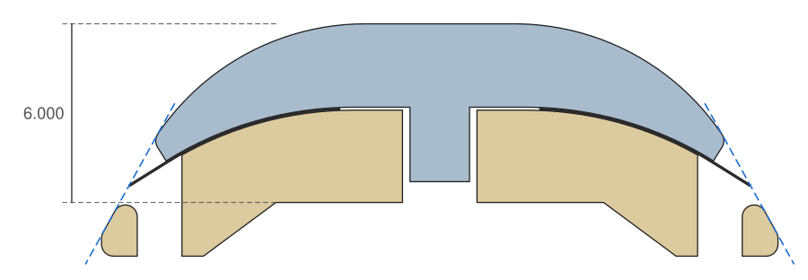
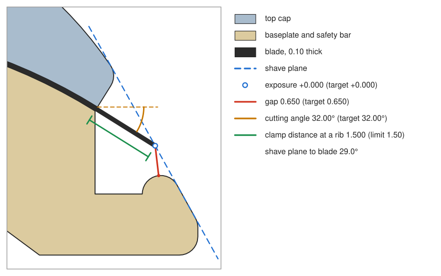
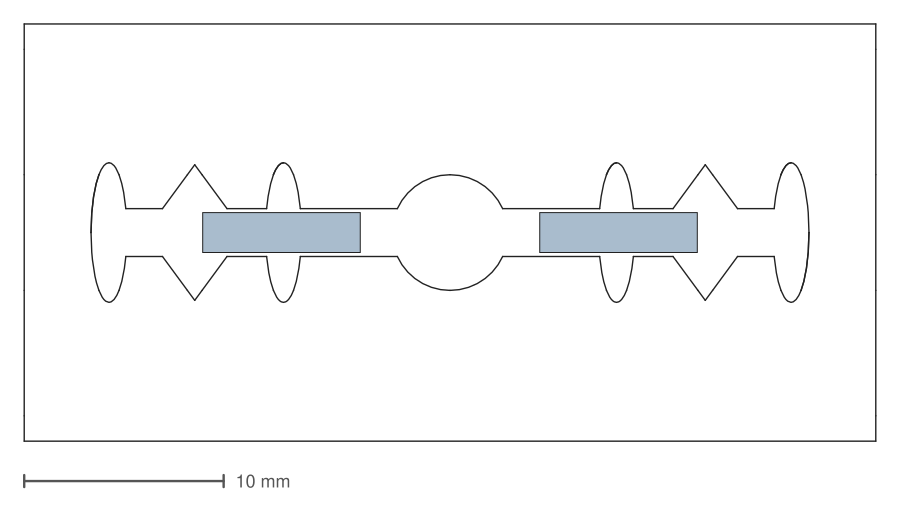
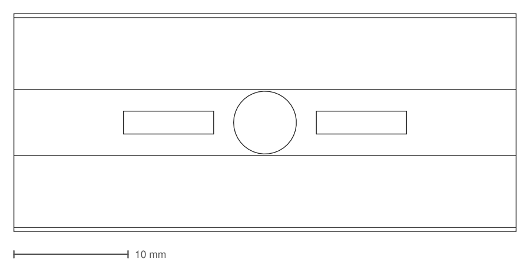
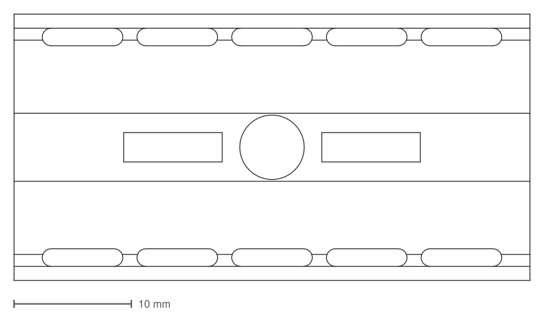

# Razor head: mild tier, prototype

**Result: PASS.** 26 of 26 hard checks pass.

`razor_head.FCMacro` (25f8096ba3fb) built this head from `config.yaml` (c3b9bba9152a) with FreeCAD 1.1.4. Run `./run.sh` to refresh this report. Dimensions are in mm and angles in degrees, measured on the built solids.

## Open values

- blade.source is null: blade dimensions are spec values, not measured (question 1)
- hardware.screw_head_dia is null: using DIN 7991 nominal 10.00 (question 5)
- hardware.screw_head_height is null: using DIN 7991 nominal 2.80 (question 5)

## Drawings

### Cross-section

Section at X = -8.08, through an alignment bar, its pocket and a drain slot. Head height is 6.000 from the seat face to the top of the cap (limit 6.00). The dashed lines mark the shave plane on each side.

### Blade edge

Section at X = -12.12, through a rib. The legend gives the measured gap, exposure, cutting angle and clamp distance.

### Blade and bars, from above

The reference blade as modelled, with the two bars (shaded) in its cutout. Narrow slot: 2.40 wide. Centre hole: 5.80 diameter. The bars clear the blade by 0.200 on each side.

### Top cap, from below

Bars: 2.000 wide, 7.900 long. Screw hole: 5.50 diameter, countersunk 10.00 on top.

### Baseplate, from above

Pockets: 2.500 wide, 8.400 long. Bore: 5.500 diameter. Drain slots: 1.50 wide, 6.88 long, 5 per side.

## Hard checks

| Result | Check | Target | Measured | Config key |
| --- | --- | --- | --- | --- |
| PASS | blade gap | 0.650 | 0.6500 / 0.6500 (+Y / -Y) | `shave.tiers.mild.gap` |
| PASS | blade exposure | +0.000 | +0.0000 .. +0.0000 | `shave.tiers.mild.exposure` |
| PASS | cutting angle | 32.00 | 32.0000 .. 32.0000 | `shave.bend_angle` |
| PASS | shave geometry, both processes | equal | max diff 0.000000 (vs production) | `process` |
| PASS | top cap identical for every tier | 0 | residual 0.000000 mm3 (3 tiers) | `shave.tiers` |
| PASS | clamp distance, at the ribs | <= 1.50 | 1.5000 (cap 1.5000, base 1.5000) | `fit.clamp_max` |
| PASS | head height | <= 6.00 | 6.0000 | `head.max_height` |
| PASS | head covers the blade envelope | >= 43.10 | 44.000 | `head.length, blade.envelope_length` |
| PASS | bars inside the blade cutout | >= 0 | hole 1.600, cutout end 5.600, blade 0.200 | `bars.*, blade.neck_width, blade.cutout` |
| PASS | bars pass through any DE blade | play >= 0.05, reach <= 12.40 | width 2.0000, play 0.0500, reach 12.4000 | `bars.width, bars.min_play, blade.any_blade` |
| PASS | pocket = bar + clearance per side | 0.250 | 0.2500 .. 0.2500 (8 sides) | `process_limits.prototype.part_clearance` |
| PASS | wall: pocket to edge | >= 1.20 | 7.4056 | `process_limits.prototype.min_wall` |
| PASS | wall: bore to pocket | >= 1.20 | 1.5000 | `process_limits.prototype.min_wall` |
| PASS | wall: drainage slot to edge | >= 1.20 | 1.2000 | `process_limits.prototype.min_wall` |
| PASS | wall: rib between drain slots | >= 1.20 | 1.2000 | `process_limits.prototype.min_wall` |
| PASS | wall: countersink / screw hole to bar | >= 1.20 | 1.6263 | `process_limits.prototype.min_wall` |
| PASS | drain slot width | >= 1.50 | 1.5000 (20 slot ends) | `baseplate.drain_slot_min_width` |
| PASS | top cap is one valid solid | 1 solid | 1 solid, valid True, 1980.0 mm3 |  |
| PASS | baseplate is one valid solid | 1 solid | 1 solid, valid True, 2434.5 mm3 |  |
| PASS | cutter residual | 0 | 0.000000 mm3 |  |
| PASS | interference cap / blade / baseplate | 0 | 0.000000 mm3 |  |
| PASS | bar tips stay above the seat face | >= 0 | 0.700 | `bars.height` |
| PASS | STEP read-back: top_cap | dV 0 | solids 1, dV 0.000073 mm3 |  |
| PASS | 3MF read-back: top_cap | dV/V < 1e-03 | 4068 facets, solid True, dV/V 7.1e-05 |  |
| PASS | STEP read-back: baseplate | dV 0 | solids 1, dV 0.000046 mm3 |  |
| PASS | 3MF read-back: baseplate | dV/V < 1e-03 | 13348 facets, solid True, dV/V 1.3e-04 |  |

## Reported values

The brief sets no limit on these.

| Item | Value | Note |
| --- | --- | --- |
| pocket width / length | 2.500 / 8.400 | through-pockets |
| clamp under a drain slot | 2.060 | OVER fit.clamp_max 1.50; support is cut back over each 6.88 slot; ribs 1.20 |
| blade reveal | 0.896 | edge beyond the cap, seen from above |
| blade play, modelled blade | +/-0.200 | slot 2.40, bars 2.00 |
| edge slid out 0.20 | gap 0.538, exp +0.097, clamp 1.700 | the other edge moves the opposite way |
| edge slid in 0.20 | gap 0.785, exp -0.097, clamp 1.300 | the other edge moves the opposite way |
| shave plane to blade | 28.97 deg | skin angle at the edge |
| bend radius | 11.817 | derived (head.bend_radius null) |
| head depth (Y) | 22.711 | OUTSIDE head.depth_range 19.00-20.50 |
| overall Z extent | 7.804 | guard wings sit 1.80 below the seat face |
| handle seat flat width | 11.000 | baseplate.handle_seat_dia 11.00 |

## Derived values

The config has no key for these yet. The generator derives each one by the rule shown.

| Key | Value | Rule |
| --- | --- | --- |
| `cap.crown_thickness` | 2.8 | hardware.screw_head_height (screw head sits flush) |
| `cap.crown_flat` | 5 | hardware.post_dia (flat width on top of the cap) |
| `cap.lip_thickness` | 0.8 | 2 x finish.edge_break |
| `guard.apex_radius` | 0.4 | finish.edge_break |
| `guard.width` | 1.2 | process min_wall |
| `guard.slot_count` | 5 | 5 per side |
| `guard.rib_width` | 1.2 | process min_wall |
| `guard.end_wall` | 2.4 | 2 x process min_wall |
| `baseplate.thickness` | 3.1 | head.max_height - blade.thickness - cap.crown_thickness |
